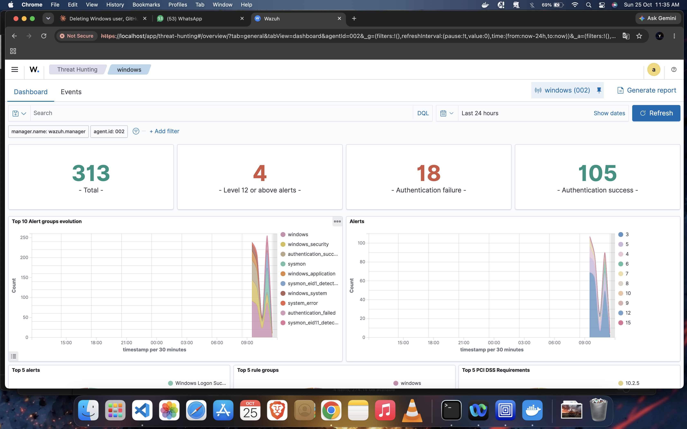
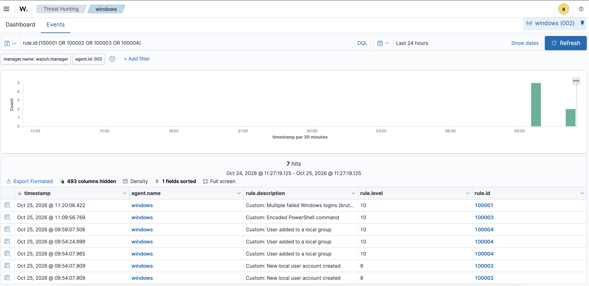
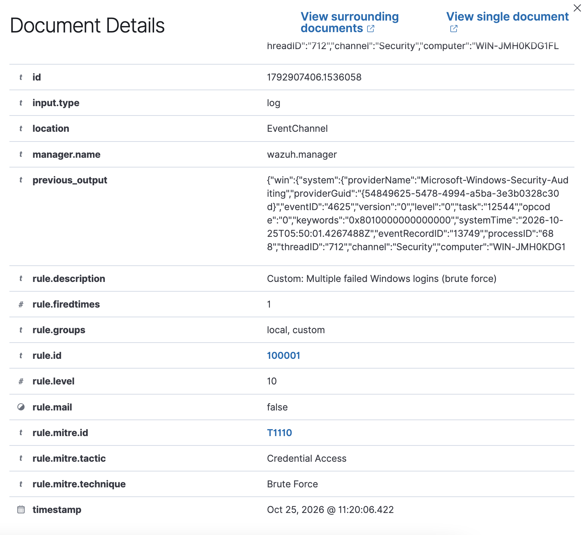
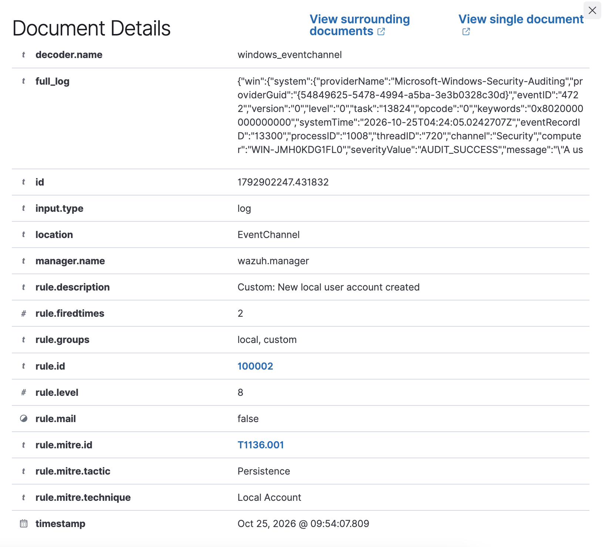
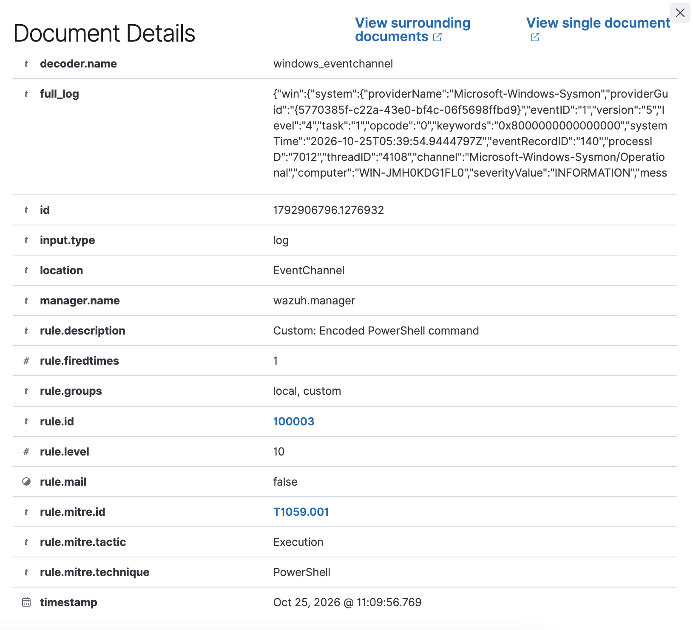
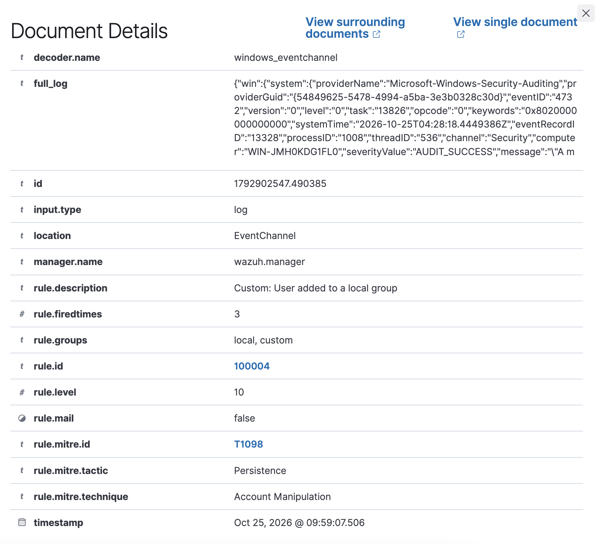
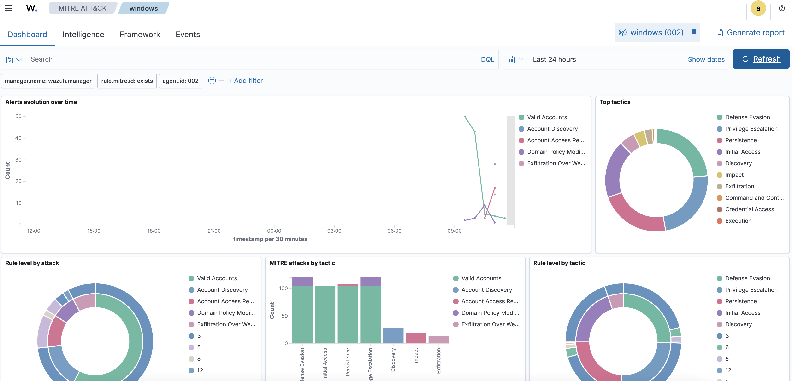

# SIEM Home Lab: Wazuh Detection Engineering

A home SIEM lab where I ingested Windows logs into Wazuh, wrote 4 custom detection rules mapped to MITRE ATT&CK, and validated each one with a simulated attack.

## Lab setup
- **SIEM:** Wazuh 4.9.0 (manager, indexer, dashboard) running in Docker on macOS
- **Endpoint:** Windows 11 VM (UTM) with Wazuh agent and Sysmon
- **Log sources:** Windows Security, System and Sysmon event logs
- **Network:** UTM shared network, agent connects to the manager on ports 1514 and 1515

## Detection rules
| Rule ID | Detection | MITRE ATT&CK | Log source |
|---|---|---|---|
| 100001 | Multiple failed Windows logins | T1110 Brute Force | Security (4625) |
| 100002 | New local user account created | T1136.001 Create Account: Local Account | Security (4720) |
| 100003 | Encoded PowerShell command | T1059.001 PowerShell | Sysmon (Event 1) |
| 100004 | User added to a local group | T1098 Account Manipulation | Security (4732) |

Rules are in [rules/local_rules.xml](rules/local_rules.xml). Test results are in [detections.md](detections.md).

## Screenshots
**Agent connected**

**All custom rules firing**

**Rule 100001: brute force (T1110)**

**Rule 100002: new user (T1136.001)**

**Rule 100003: encoded PowerShell (T1059.001)**

**Rule 100004: group change (T1098)**

**MITRE ATT&CK view**

## What I learned
- **Filebeat 401 error:** alerts reached the manager but not the dashboard because the manager used a different indexer password than the indexer expected. Fixing the password setting in docker-compose solved it.
- **Agent config:** a localfile block placed after the closing ossec_config tag stopped the agent from starting (error 1230). It must sit inside the config section.
- **Rule ID clash:** Wazuh's default local_rules.xml already uses ID 100001, so I replaced the file with my own rules.
- **Rule chaining:** building rule 100001 on Wazuh's built-in rule 60204 (multiple logon failures) was more reliable than writing my own frequency rule.
- **Sysmon is needed for process-level detections** like encoded PowerShell. Windows Security logs alone were not enough.

## Next steps
- Add a Linux agent and SSH brute force detection
- Add detections for persistence (scheduled tasks, registry run keys)
- Forward alerts to a ticketing or SOAR workflow
